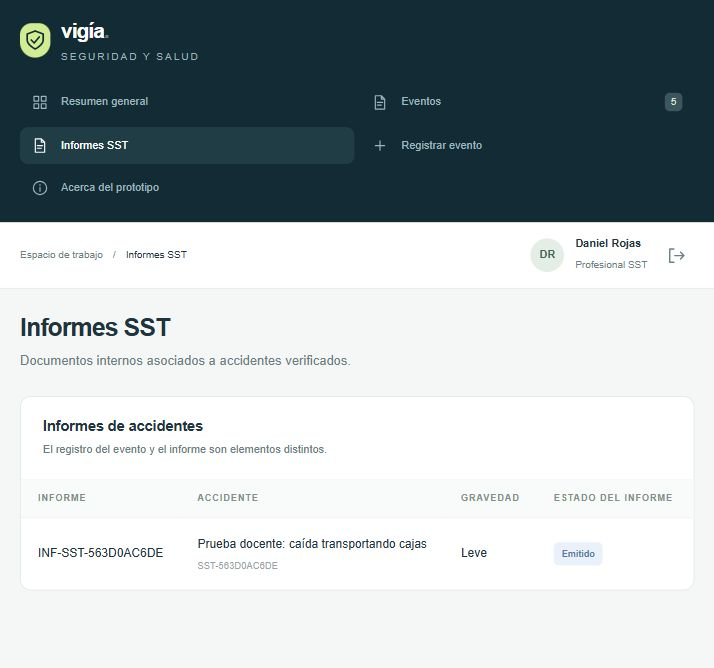

# Vigía SST

Prototipo académico de una aplicación web para registrar y hacer seguimiento a accidentes e incidentes laborales.

Versión actual: 1.0.0.

[Enlaces y alcance de la entrega final](docs/Entrega-Final.md).

**Aplicación desplegada:** [vigia-sst-io46.onrender.com](https://vigia-sst-io46.onrender.com) · **Wiki:** [documentación del proyecto](https://github.com/HEFRA-ws/ProyectoIngSoftware/wiki) · **Arquitectura:** [docs/Arquitectura.md](docs/Arquitectura.md)

> El servicio usa el plan gratuito de Render: si lleva un rato sin uso, la primera carga puede tardar cerca de un minuto.

## Corrección de la versión 0.2

El **evento** es la declaración inicial del accidente o incidente. El **informe interno SST** es un documento posterior y separado, creado solo para un accidente verificado. La investigación se mantiene para ambos tipos. Emitir un informe no cierra el evento.

Al iniciar se migran los registros de `reports` a `events` y los vínculos de evidencia a `eventId`, conservando los códigos. No se inventa gravedad para clasificaciones antiguas: requieren verificación SST. La API de eventos ahora utiliza `/api/events`; los informes están en `/api/accident-reports`.

Las observaciones del profesor y las decisiones de formato propuestas por el equipo están en [Correcciones](docs/Correcciones.md). El formulario interno no es FURAT ni realiza envío a la ARL.

## Tecnologías

| Capa | Tecnología |
| --- | --- |
| Interfaz | HTML, CSS, JavaScript y Bootstrap 5 |
| API REST | Node.js 24 y Express 5 |
| Persistencia | MongoDB y controlador oficial para Node.js |
| Calidad | Node Test Runner y GitHub Actions |
| Despliegue | Render (servicio web) y MongoDB Atlas (cluster M0) |

El proyecto parte del dominio y las historias documentadas en [Avance-1-de-Proyecto](https://github.com/JuanesBD/Avance-1-de-Proyecto). La implementación de esta versión utiliza Node.js y Express en lugar de Java y Spring Boot. El cambio busca mantener un solo lenguaje en interfaz y servidor.

## Funcionalidades actuales

- Inicio de sesión con correo y contraseña para cuentas existentes. Registro e inicio con Google: las cuentas nuevas se crean como Trabajador. Sesiones de ocho horas y permisos verificados en el servidor.
- Registro inicial de accidentes e incidentes por el trabajador, con código, actividad y personas involucradas. Nombre y correo se recuperan de la cuenta; permite reutilizar personas de sus eventos previos, incluida la edad si fue registrada. SST verifica, investiga y gestiona el seguimiento.
- El informe SST precarga nombre, identificación, contacto, edad disponible, actividad y fecha del evento. Los datos desconocidos quedan vacíos y la verificación profesional se completa aparte.
- Carga y descarga autorizada de PNG, JPG y PDF, hasta 2 MB por archivo y cinco adjuntos por reporte.
- Consulta y búsqueda por código, título y área; filtros por tipo y estado.
- Verificación de SST e investigación de causas. Accidentes clasificados como Leve, Grave o Mortal.
- Informe interno del accidente independiente del evento, con campos estructurados, borrador, emisión e historial propio. Los incidentes conservan investigación.
- Acciones correctivas con responsable, fecha límite, estado, historial y descripción de evidencia; SST puede cerrar el caso cuando todas estén completadas. Para accidentes también se exige el informe interno Emitido; no se admiten nuevos adjuntos en un evento cerrado.
- Historial de cambios y resumen básico calculado con los datos visibles para cada rol.

Pendientes: carga de archivos como evidencia de acciones, notificaciones, estadísticas avanzadas, exportación del informe y administración completa de usuarios. El registro e inicio con Google están habilitados en la web pública; para otra instalación requieren configurar sus variables OAuth. No existe un formulario público de registro con contraseña. Consulta [la guía de Google](docs/Google-Auth.md).

## Guía de instalación en un computador nuevo

### 1. Requisitos

| Herramienta | Versión | Cómo comprobarla |
| --- | --- | --- |
| [Node.js](https://nodejs.org/) | 24 LTS (el proyecto exige `>=24 <25`) | `node -v` |
| [Git](https://git-scm.com/downloads) | Cualquiera reciente | `git --version` |
| pnpm | 10 o superior, se activa con Corepack (incluido en Node.js) | `pnpm -v` |

También se necesita conexión a internet en la primera instalación.

### 2. Clonar e instalar

```bash
git clone https://github.com/HEFRA-ws/ProyectoIngSoftware.git
cd ProyectoIngSoftware
corepack enable
pnpm install --frozen-lockfile --ignore-scripts
```

Si `pnpm -v` muestra una versión 9 o anterior, ejecuta `corepack prepare pnpm@latest --activate`.

**Windows:** si PowerShell no reconoce `pnpm` o `corepack enable` falla por permisos, antepón `corepack` a cada comando; por ejemplo, usa `corepack pnpm install --frozen-lockfile --ignore-scripts` y `corepack pnpm start`. Así no tienes que habilitar Corepack globalmente.

### 3. Configurar variables de entorno

Copia `.env.example` como `.env`:

```bash
# Linux / macOS / Git Bash
cp .env.example .env
```

```powershell
# PowerShell
Copy-Item .env.example .env
```

Edita `.env` y pon en `DEMO_PASSWORD` una contraseña de al menos 12 caracteres. Deja `MONGODB_URI` vacía para usar la base local de desarrollo, o pega una conexión de MongoDB Atlas para usar la nube.

### 4. Ejecutar

```bash
pnpm start
```

Abre `http://localhost:3000` e inicia sesión con uno de los accesos de demostración (tabla siguiente).

Si `MONGODB_URI` está vacía y `DEMO_MODE=true`, se inicia un proceso MongoDB local mediante `mongodb-memory-server`. La primera ejecución descarga el binario oficial de MongoDB y puede tardar varios minutos. Los datos se guardan en `data/`. No utiliza SQLite ni localStorage como base de datos.

En producción (`NODE_ENV=production`) el servidor exige `MONGODB_URI` y no inicia el MongoDB de desarrollo.

### 5. Problemas frecuentes

| Síntoma | Solución |
| --- | --- |
| `pnpm` no se reconoce o Corepack no puede crear enlaces | Usa `corepack pnpm ...` en Windows, como se explica arriba. |
| `ERR_PNPM_... packages field missing or empty` | Se está usando pnpm 9. Ejecuta `corepack prepare pnpm@latest --activate` y vuelve a abrir la terminal |
| `Unsupported engine` o errores de sintaxis al iniciar | Instala Node.js 24 LTS |
| `Configura MONGODB_URI para conectar MongoDB.` | Estás en modo producción o con `DEMO_MODE` distinto de `true`; define `MONGODB_URI` |
| La primera ejecución se queda descargando | Es la descarga única del binario de MongoDB local; espera o usa una URI de Atlas |
| `EADDRINUSE: 3000` | Otro programa usa el puerto; cambia `PORT` en `.env` |
| No funciona el login con la contraseña nueva | Cambiar `DEMO_PASSWORD` no modifica usuarios existentes. Usa la contraseña inicial de esa base. Para una demostración nueva, detén el servidor y configura otro `DATA_DIR`, conservando los datos anteriores |

### Accesos de demostración

| Rol | Correo | Permiso principal |
| --- | --- | --- |
| Trabajador | trabajador@vigia.demo | Registrar eventos, adjuntar su evidencia y consultar solo sus casos |
| Trabajador | trabajador2@vigia.demo | Segundo trabajador de demostración (Jorge Castillo) |
| Trabajador | trabajador3@vigia.demo | Tercer trabajador de demostración (Marcela Ortiz) |
| Profesional SST | sst@vigia.demo | Consultar todos los casos; verificar, investigar, asignar acciones, cerrar y elaborar informes |
| Coordinador | coordinador@vigia.demo | Consultar todos los eventos, informes y evidencias; sin cambios operativos |
| Administrador | admin@vigia.demo | Consulta general y respuesta a quejas; gestión de usuarios pendiente |

Las cuatro cuentas base se crean si la colección de usuarios está vacía. La precarga añade trabajador2 y trabajador3 si faltan. Cada cuenta recibe el valor de `DEMO_PASSWORD` vigente al crearla; cambiar esa variable después no modifica sus contraseñas.

### Datos precargados

Con `DEMO_MODE=true`, el servidor carga datos ficticios (`lib/demo-data.js`): seis cuentas, diez eventos en distintos estados, personas afectadas y testigos, acciones correctivas, tres informes SST y dos quejas o reclamos. Los nombres, documentos (`CC-DEMO-…`) y casos son inventados. La carga no duplica registros ni sobrescribe cambios; si se borra la base local, se vuelve a crear al iniciar.

## Variables de entorno

| Variable | Uso |
| --- | --- |
| `PORT` | Puerto HTTP; Render lo asigna automáticamente |
| `MONGODB_URI` | Conexión privada de MongoDB; obligatoria en producción |
| `MONGODB_DB` | Nombre de la base de datos; por defecto `vigia` |
| `DEMO_MODE` | Habilita la creación inicial de cuentas y registros ficticios |
| `DEMO_PASSWORD` | Contraseña inicial de demostración, mínimo 12 caracteres |
| `DATA_DIR` | Directorio del MongoDB local de desarrollo |
| `COOKIE_SECURE` | `true` cuando la aplicación se sirve mediante HTTPS |
| `NODE_ENV` | `production` en el alojamiento |
| `GOOGLE_CLIENT_ID` | ID del cliente OAuth web; opcional |
| `GOOGLE_CLIENT_SECRET` | Secreto privado del cliente OAuth; opcional |
| `GOOGLE_REDIRECT_URI` | URL autorizada terminada en `/auth/google/callback`; opcional |

`.env`, `data/` y `node_modules/` están excluidos de Git. Las credenciales de Atlas se configuran en el servidor, nunca en el JavaScript del navegador.

## Pruebas

```bash
pnpm test
```

Las pruebas de integración levantan bases MongoDB aisladas y servidores en puertos temporales. Verifican autenticación, autorización, validaciones, separación de eventos e informes, verificación, investigación y emisión, acciones correctivas y cierre de eventos, quejas y reclamos, adjuntos y cierre de sesión. La suite de Google prueba el registro y valida tokens firmados localmente; sustituye únicamente la comunicación con el proveedor y no acredita un acceso real a Google. El flujo de GitHub Actions ejecuta estas comprobaciones en cada push a `main` y en pull requests.

Consulta [Historias de usuario](docs/Historias-de-usuario.md), [Correcciones](docs/Correcciones.md), [Diagramas](docs/Diagramas.md), [Calidad](docs/Calidad.md), [Riesgos](docs/Riesgos.md), [Gestión de configuración](docs/GCS.md) y [Plan de sprints](docs/Sprints.md).

Documentación en [la wiki](https://github.com/HEFRA-ws/ProyectoIngSoftware/wiki). Seguimiento en [GitHub Projects](https://github.com/users/HEFRA-ws/projects/2). El documento de GCS se entrega también [en PDF fuera de la wiki](docs/GCS.pdf).

[Diapositivas de la entrega final](docs/Presentacion-Final-Vigia-SST.pptx) y [vista en PDF](docs/Presentacion-Final-Vigia-SST.pdf). Se conserva como referencia histórica la [primera demostración, versión 0.1](docs/Presentacion-Vigia-SST.pptx).



## Despliegue

Producción: **[https://vigia-sst-io46.onrender.com](https://vigia-sst-io46.onrender.com)**, servida por Render con la base en MongoDB Atlas.

| Parámetro de Render | Valor |
| --- | --- |
| Build Command | `corepack enable && pnpm install --frozen-lockfile --prod --ignore-scripts` |
| Start Command | `node server.js` |
| Health Check Path | `/api/health` |
| Variables públicas | `NODE_VERSION=24.19.0`, `NODE_ENV=production`, `COOKIE_SECURE=true`, `DEMO_MODE=true`, `MONGODB_DB=vigia` |
| Variables privadas | `MONGODB_URI`, `DEMO_PASSWORD` |

El archivo `render.yaml` contiene la misma configuración como Blueprint. El paso a paso de Atlas y Render y la lista de verificación están en [la guía de despliegue](docs/Despliegue.md); los resultados de las pruebas sobre la URL pública, en [Calidad](docs/Calidad.md).

## Alcance académico

Utilizar exclusivamente datos ficticios. El prototipo no acredita cumplimiento normativo ni sustituye un sistema empresarial de SST. La carga de archivos valida cabecera, tipo y tamaño; no incluye antivirus ni análisis completo del documento. Las métricas básicas no equivalen al tablero avanzado previsto para el siguiente sprint.

Desarrollo asistido por OpenAI Codex. El equipo debe revisar, comprender y validar la implementación antes de presentarla.
