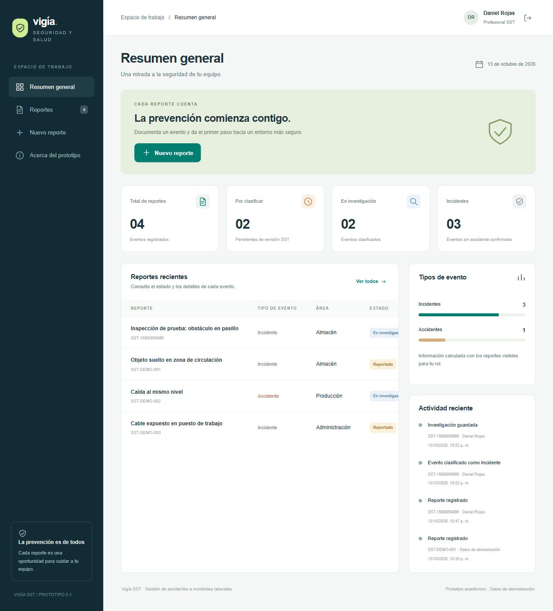

# Vigía SST

Prototipo académico de una aplicación web para registrar y hacer seguimiento a accidentes e incidentes laborales.

## Tecnologías

| Capa | Tecnología |
| --- | --- |
| Interfaz | HTML, CSS, JavaScript y Bootstrap 5 |
| API REST | Node.js 24 y Express 5 |
| Persistencia | MongoDB y controlador oficial para Node.js |
| Calidad | Node Test Runner y GitHub Actions |
| Despliegue previsto | Render y MongoDB Atlas |

El proyecto parte del dominio y las historias documentadas en [Avance-1-de-Proyecto](https://github.com/JuanesBD/Avance-1-de-Proyecto). La implementación de esta versión utiliza Node.js y Express en lugar de Java y Spring Boot. El cambio busca mantener un solo lenguaje en interfaz y servidor.

## Funcionalidades actuales

- Inicio de sesión con correo y contraseña, sesiones de ocho horas y permisos verificados en el servidor.
- Registro de accidentes e incidentes con código único y personas involucradas.
- Carga y descarga autorizada de PNG, JPG y PDF, hasta 2 MB por archivo y cinco adjuntos por reporte.
- Consulta y búsqueda por código, título y área; filtros por tipo y estado.
- Clasificación del evento e investigación de causas por el profesional SST.
- Historial de cambios y resumen básico calculado con los datos visibles para cada rol.

Pendientes: acciones correctivas y cierre de casos, notificaciones, estadísticas avanzadas, exportación del informe y administración completa de usuarios. El inicio con Google también queda fuera de esta versión.

## Ejecución local

Requisitos: Node.js 24 LTS, Git y conexión a internet en la primera instalación.

```bash
git clone https://github.com/HEFRA-ws/ProyectoIngSoftware.git
cd ProyectoIngSoftware
corepack enable
pnpm install --frozen-lockfile --ignore-scripts
```

Copia `.env.example` como `.env`. En PowerShell:

```powershell
Copy-Item .env.example .env
```

Configura una contraseña de demostración de al menos 12 caracteres en `DEMO_PASSWORD`, y ejecuta:

```bash
pnpm start
```

Abre `http://localhost:3000`. Si `MONGODB_URI` está vacío y `DEMO_MODE=true`, se inicia un proceso MongoDB local mediante `mongodb-memory-server`. La primera ejecución descarga el binario oficial de MongoDB; puede tardar varios minutos. Aunque la biblioteca se denomina memory-server, esta configuración utiliza WiredTiger y guarda datos en `data/`. No utiliza SQLite ni localStorage como base de datos.

En producción el servidor exige `MONGODB_URI`; no inicia el MongoDB de desarrollo.

### Accesos de demostración

| Rol | Correo | Permiso principal |
| --- | --- | --- |
| Trabajador | trabajador@vigia.demo | Crear y consultar sus propios reportes |
| Profesional SST | sst@vigia.demo | Consultar, clasificar e investigar eventos |
| Coordinador | coordinador@vigia.demo | Consultar todos los reportes y su evidencia |
| Administrador | admin@vigia.demo | Acceso operativo a los eventos; gestión de usuarios pendiente |

Los cuatro accesos usan el valor de `DEMO_PASSWORD`. Los usuarios se crean únicamente si la colección de usuarios está vacía. Cambiar esa variable después no cambia las contraseñas de usuarios existentes.

## Variables de entorno

| Variable | Uso |
| --- | --- |
| `PORT` | Puerto HTTP; Render lo asigna automáticamente |
| `MONGODB_URI` | Conexión privada de MongoDB; obligatoria en producción |
| `MONGODB_DB` | Nombre de la base de datos; por defecto `vigia` |
| `DEMO_MODE` | Habilita la creación inicial de cuentas y registros ficticios |
| `DEMO_PASSWORD` | Contraseña inicial de demostración, mínimo 12 caracteres |
| `DATA_DIR` | Directorio del MongoDB local de desarrollo |
| `COOKIE_SECURE` | `true` cuando la aplicación se sirve mediante HTTPS |
| `NODE_ENV` | `production` en el alojamiento |

`.env`, `data/` y `node_modules/` están excluidos de Git. Las credenciales de Atlas se configuran en el servidor, nunca en el JavaScript del navegador.

## Pruebas

```bash
pnpm test
```

Las pruebas de integración levantan una base MongoDB aislada y un servidor en un puerto temporal. Verifican autenticación, autorización, validaciones, separación de reportes, clasificación, investigación, adjuntos y cierre de sesión. El flujo de GitHub Actions ejecuta estas comprobaciones en cada push a `main` y en pull requests.

Consulta [Calidad](docs/Calidad.md), [Riesgos](docs/Riesgos.md), [Gestión de configuración](docs/GCS.md) y [Plan de sprints](docs/Sprints.md).

Documentación en [la wiki](https://github.com/HEFRA-ws/ProyectoIngSoftware/wiki). Seguimiento en [GitHub Projects](https://github.com/users/HEFRA-ws/projects/2). El documento de GCS se entrega también [en PDF fuera de la wiki](docs/GCS.pdf).

[Diapositivas de la primera demostración](docs/Presentacion-Vigia-SST.pptx).



## Despliegue

El archivo `render.yaml` prepara un servicio Node.js en Render. Antes de desplegar es necesario crear la base en MongoDB Atlas y configurar `MONGODB_URI` y `DEMO_PASSWORD` como valores privados en Render.

Consulta [la guía de despliegue](docs/Despliegue.md). Esta versión no incluye una URL pública de la aplicación hasta completar y verificar ese despliegue.

## Alcance académico

Utilizar exclusivamente datos ficticios. El prototipo no acredita cumplimiento normativo ni sustituye un sistema empresarial de SST. La carga de archivos valida cabecera, tipo y tamaño; no incluye antivirus ni análisis completo del documento. Las métricas básicas no equivalen al tablero avanzado previsto para el siguiente sprint.

Desarrollo asistido por OpenAI Codex. El equipo debe revisar, comprender y validar la implementación antes de presentarla.
