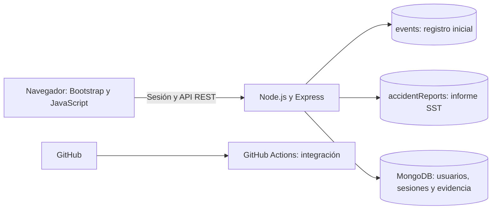
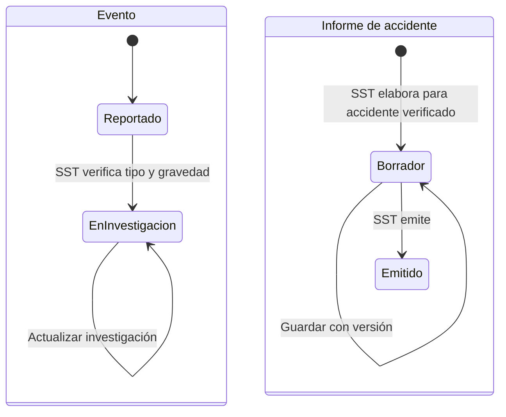

# Arquitectura y modelo de datos

Versión 0.2. El registro del evento, su investigación y el informe interno del accidente son elementos distintos.

## Colecciones y responsabilidades

| Colección | Información | Control |
| --- | --- | --- |
| users | Cuenta, hash de contraseña y rol | Autenticación |
| sessions | Hash del token, usuario y expiración | Cookie HttpOnly y TTL |
| events | Declaración, actividad, personas, verificación, investigación e historial | Propietario, rol y versión |
| accidentReports | Documento interno, evento asociado, autor, gravedad, datos verificados y estado propio | Un informe por accidente; solo SST edita |
| evidence | Binario y metadatos asociados a eventId | Autorización en carga y descarga |
| attempts | Intentos fallidos y expiración | Limitación de login |

Los catálogos iniciales de actividad, mecanismo, lesión y parte afectada se definen en `lib/accident-reports.js` y se entregan a la interfaz mediante la API. Son opciones internas del prototipo, no un catálogo oficial FURAT.

## Estados y reglas

El estado del informe no sustituye al del evento. Emitirlo no cierra el caso. Un incidente puede investigarse, pero no genera informe de accidente. No hay integración con ARL, FURAT, firma digital ni exportación PDF de este informe todavía.

## Permisos

| Acción | Trabajador | Profesional SST | Coordinador | Administrador |
| --- | --- | --- | --- | --- |
| Registrar evento | Sí | Sí | No | Sí |
| Consultar eventos e informes | Propios | Todos | Todos | Todos |
| Adjuntar evidencia | Propios | Todos | No | Todos |
| Verificar e investigar | No | Sí | No | Sí |
| Crear, editar y emitir informe | No | Sí | No | Sí |

Los borradores también son consultables por el propietario del evento; la escritura se reserva a SST y administrador. El módulo de administración de cuentas sigue pendiente.

## API del dominio

| Método | Ruta | Operación |
| --- | --- | --- |
| GET / POST | /api/events | Consultar o registrar evento |
| PATCH | /api/events/:id | Verificar con acción classify o investigar con acción investigate |
| GET / POST | /api/events/:id/evidence | Consultar o adjuntar evidencia |
| GET | /api/events/:id/evidence/:fileId | Descargar evidencia |
| GET | /api/report-options | Catálogos del formulario SST |
| GET | /api/accident-reports | Informes autorizados |
| GET / POST / PUT | /api/events/:id/report | Consultar, crear o actualizar borrador |
| POST | /api/events/:id/report/finalize | Emitir la versión guardada |
| GET / POST | /api/complaints | Consultar o radicar quejas y reclamos |
| PATCH | /api/complaints/:id | Responder una queja o un reclamo (SST o Administrador) |

Las rutas /api/login, /api/me, /api/logout y /api/health se mantienen. Las rutas antiguas /api/reports se sustituyen por /api/events. Debe actualizarse el navegador junto al servidor.

## Migración de la versión 0.1

Al iniciar, `lib/migrations.js` renombra la colección antigua reports a events, conservando documentos, códigos e historial. También cambia el vínculo de evidencia reportId a eventId. Si ya existen ambas colecciones, detiene el arranque para evitar sobrescribir datos. La operación es idempotente y tiene prueba de integración.

Las clasificaciones antiguas no se convierten en verificaciones nuevas con gravedad inventada. El caso debe ser revisado por SST; la investigación anterior permanece guardada. Los informes internos se crean solo mediante una acción explícita.

## Diagramas

[Clases](Diagrama-Clases.md), [secuencias](Diagrama-Secuencias.md) y [entidad-relación](Diagrama-ER.md).
