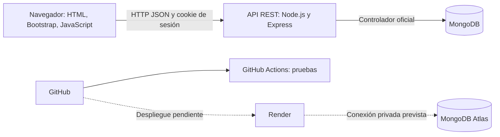
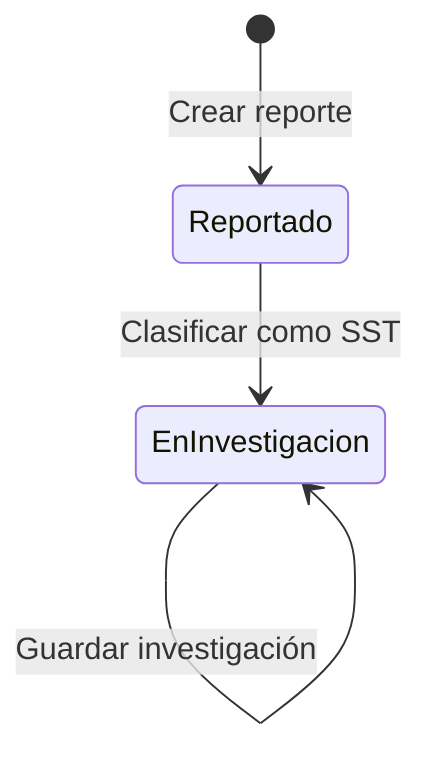

# Arquitectura y modelo de datos

## Arquitectura

La interfaz y la API se sirven desde el mismo origen. No se requiere configurar CORS. En desarrollo se puede iniciar MongoDB local con persistencia en disco; en producción se usa Atlas.

## Colecciones

| Colección | Campos principales | Finalidad |
| --- | --- | --- |
| users | id, name, email, password, role | Cuentas, hash con sal y roles |
| sessions | _id, userId, expires | Hash del token y expiración |
| reports | id, owner, reporter, title, type, area, location, date, status, people, classification, investigation, history, version | Evento y trazabilidad |
| evidence | id, reportId, name, type, size, content, createdAt | Archivos binarios asociados al evento |
| attempts | _id, count, expires | Límite de intentos fallidos |

Las personas involucradas, la clasificación, la investigación y el historial se embeben en el reporte. Los adjuntos se separan para no cargar binarios al consultar listados. Los índices TTL eliminan sesiones e intentos expirados; el servidor comprueba la fecha de sesión incluso antes de que MongoDB elimine el registro.

## Estados del prototipo

La siguiente versión definirá acciones correctivas, validación de cumplimiento y cierre. No existe un botón de cierre simulado.

## Permisos

| Acción | Trabajador | SST | Coordinador | Administrador |
| --- | --- | --- | --- | --- |
| Crear reporte | Sí | Sí | Sí | Sí |
| Ver reportes | Propios | Todos | Todos | Todos |
| Adjuntar evidencia | Propios | Todos | No | Todos |
| Descargar evidencia | Propios | Todos | Todos | Todos |
| Clasificar e investigar | No | Sí | No | Sí |

El coordinador puede crear un reporte inicial como usuario, pero en los casos existentes su función de seguimiento es de consulta. La gestión administrativa de cuentas queda pendiente.

## API

| Método | Ruta | Operación |
| --- | --- | --- |
| GET | /api/health | Estado del servidor y conexión a MongoDB |
| POST | /api/login | Validar credenciales y crear sesión |
| GET | /api/me | Consultar usuario autenticado |
| POST | /api/logout | Eliminar sesión |
| GET | /api/reports | Listar reportes autorizados |
| POST | /api/reports | Registrar evento |
| PATCH | /api/reports/:id | Clasificar o guardar investigación |
| GET | /api/reports/:id/evidence | Listar metadatos de adjuntos |
| POST | /api/reports/:id/evidence | Validar y guardar adjunto |
| GET | /api/reports/:id/evidence/:fileId | Descargar adjunto autorizado |

La actualización de clasificación e investigación utiliza el campo `version` para detectar modificaciones simultáneas. Un conflicto devuelve HTTP 409.
