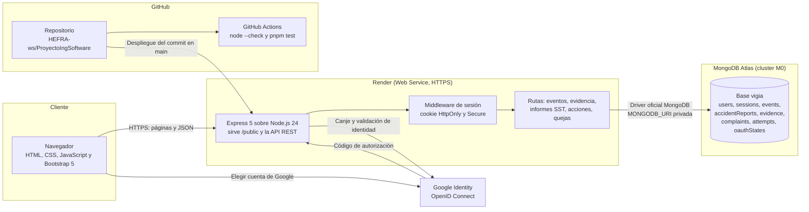
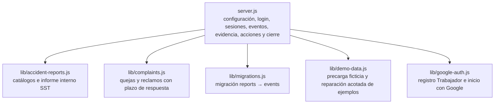
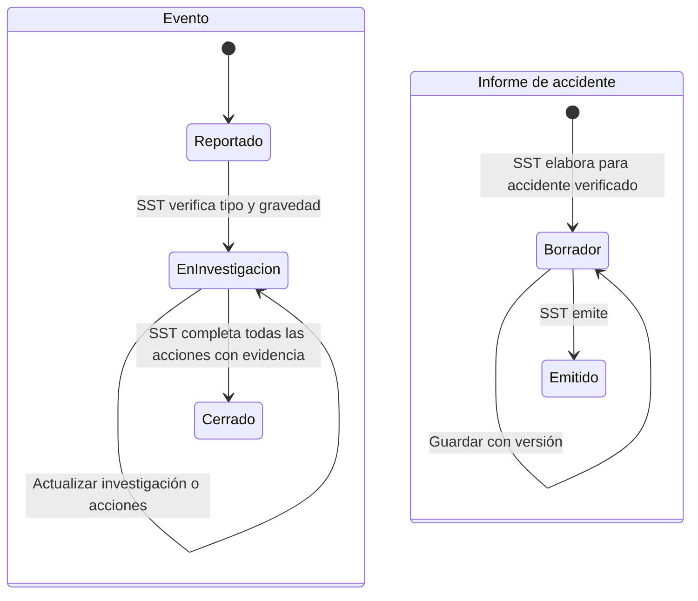

# Arquitectura y modelo de datos

Versión 1.0 (entrega final). El registro del evento, su investigación y el informe interno del accidente son elementos distintos.

## Arquitectura de despliegue

El navegador nunca se conecta a la base: toda lectura y escritura pasa por la API, que valida la sesión y el rol en el servidor. La cadena `MONGODB_URI` y `DEMO_PASSWORD` se configuran como variables privadas en Render. En desarrollo local, si `MONGODB_URI` está vacía y `DEMO_MODE=true`, el servidor levanta un MongoDB local con `mongodb-memory-server`.

## Capas del servidor

## Colecciones y responsabilidades

| Colección | Información | Control |
| --- | --- | --- |
| users | Cuenta, rol y hash de contraseña local o identificador Google | Autenticación |
| sessions | Hash del token, usuario y expiración | Cookie HttpOnly y TTL |
| events | Declaración, actividad, personas, verificación, investigación, acciones correctivas, cierre e historial | Propietario, rol y versión |
| accidentReports | Documento interno, evento asociado, autor, gravedad, datos verificados y estado propio | Un informe por accidente; solo SST edita |
| evidence | Binario y metadatos asociados a eventId | Autorización en carga y descarga |
| complaints | Queja o reclamo, autor, evento relacionado, plazo y respuesta | Autor y responsables (SST, administrador) |
| attempts | Intentos fallidos y expiración | Limitación de login |
| oauthStates | Estado de acceso Google, nonce, verificador PKCE y expiración | Un solo uso, cookie del navegador y TTL de cinco minutos |

### Autenticación opcional con Google

`lib/google-auth.js` incorpora OpenID Connect mediante `google-auth-library`. El servidor canjea el código de autorización y verifica la identidad antes de crear una cuenta Trabajador o abrir la sesión existente. `users.googleSub` tiene un índice único `sparse`, que excluye las cuentas sin ese campo; las cuentas Google no necesitan un hash de contraseña local. No se vinculan cuentas por correo de forma automática. La interfaz consulta `/api/auth/config` y solo ofrece el botón cuando el entorno tiene las variables de configuración válidas; la configuración y el flujo están en [Google Auth](Google-Auth.md). La integración no cambia los permisos operativos del sistema.

Los catálogos iniciales de actividad, mecanismo, lesión y parte afectada se definen en `lib/accident-reports.js` y se entregan a la interfaz mediante la API. Son opciones internas del prototipo, no un catálogo oficial FURAT.

## Estados y reglas

Cada acción correctiva conserva responsable, fecha límite, estado y un historial propio. La evidencia se registra como descripción o referencia; adjuntar archivos de soporte continúa pendiente. El cierre exige un evento verificado e investigado, al menos una acción y todas las acciones completadas con evidencia. Solo SST puede asignarlas, actualizarlas o cerrar el evento. Para cerrar un accidente también se exige su informe interno Emitido. Un incidente no necesita ese informe. La API rechaza nuevos adjuntos en eventos cerrados.

El estado del informe no sustituye al del evento. Emitirlo no cierra el caso. Un incidente puede investigarse, pero no genera informe de accidente. No hay integración con ARL, FURAT, firma digital ni exportación PDF de este informe todavía.

## Permisos

Verificados contra el código del servidor (`server.js`, `lib/accident-reports.js`, `lib/complaints.js`) y las pruebas de integración.

| Acción | Trabajador | Profesional SST | Coordinador | Administrador |
| --- | --- | --- | --- | --- |
| Registrar evento | Sí | No | No | No |
| Consultar eventos e informes | Propios | Todos | Todos | Todos |
| Adjuntar evidencia | Propios y abiertos | No | No | No |
| Verificar e investigar | No | Sí | No | No |
| Crear, editar y emitir informe | No | Sí | No | No |
| Asignar/actualizar acciones y cerrar evento | No | Sí | No | No |
| Radicar queja o reclamo | Sí | Sí | Sí | Sí |
| Consultar quejas y reclamos | Propios | Todos | Propios | Todos |
| Responder queja o reclamo | No | Sí | No | Sí |

El propietario de un evento puede consultar el informe asociado, incluso en borrador, pero solo el profesional SST lo escribe. El módulo de administración de cuentas queda como trabajo futuro.

## API del dominio

| Método | Ruta | Operación |
| --- | --- | --- |
| GET | /api/auth/config | Disponibilidad de Google, sin secretos |
| GET | /auth/google | Iniciar autorización de Google |
| GET | /auth/google/callback | Validar identidad, registrar Trabajador si es nuevo y crear sesión |
| GET / POST | /api/events | Consultar o registrar evento |
| PATCH | /api/events/:id | Verificar con acción classify o investigar con acción investigate |
| GET / POST | /api/events/:id/evidence | Consultar o adjuntar evidencia |
| GET | /api/events/:id/evidence/:fileId | Descargar evidencia |
| GET | /api/report-options | Catálogos del formulario SST |
| GET | /api/accident-reports | Informes autorizados |
| GET / POST / PUT | /api/events/:id/report | Consultar, crear o actualizar borrador |
| POST | /api/events/:id/report/finalize | Emitir la versión guardada |
| POST | /api/events/:id/actions | Asignar una acción correctiva |
| PATCH | /api/events/:id/actions/:actionId | Actualizar estado y evidencia de una acción |
| POST | /api/events/:id/close | Cerrar evento cuando cumple las condiciones |
| GET / POST | /api/complaints | Consultar o radicar quejas y reclamos |
| PATCH | /api/complaints/:id | Responder una queja o un reclamo (SST o Administrador) |

Las rutas /api/login, /api/me, /api/logout y /api/health se mantienen. Las rutas antiguas /api/reports se sustituyen por /api/events. Debe actualizarse el navegador junto al servidor.

## Migración de la versión 0.1

Al iniciar, `lib/migrations.js` renombra la colección antigua reports a events, conservando documentos, códigos e historial. También cambia el vínculo de evidencia reportId a eventId. Si ya existen ambas colecciones, detiene el arranque para evitar sobrescribir datos. La operación es idempotente y tiene prueba de integración.

Las clasificaciones antiguas no se convierten en verificaciones nuevas con gravedad inventada. El caso debe ser revisado por SST; la investigación anterior permanece guardada. Los informes internos se crean solo mediante una acción explícita.

## Diagramas

[Clases](Diagrama-Clases.md), [secuencias](Diagrama-Secuencias.md) y [entidad-relación](Diagrama-ER.md).
