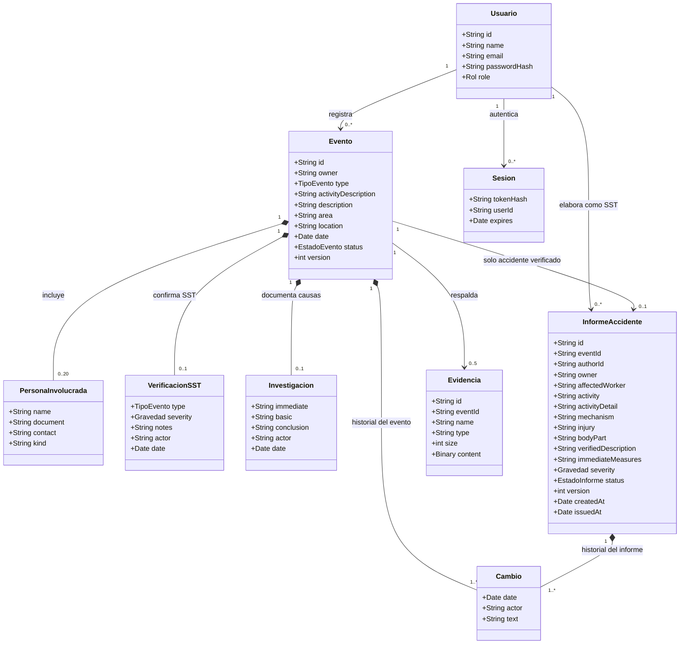

# Diagrama de clases

Modelo de dominio de la versión 0.2. El servidor está implementado con funciones y documentos MongoDB; este diagrama expresa las entidades y sus relaciones, no una jerarquía de clases Java.

Reglas: trabajador y SST registran eventos; SST y administrador verifican y elaboran informes. Coordinador consulta. La gravedad se registra únicamente para accidentes: Leve, Grave o Mortal. Los incidentes conservan investigación sin generar InformeAccidente. El informe pasa de Borrador a Emitido; emitirlo no cierra el evento.
