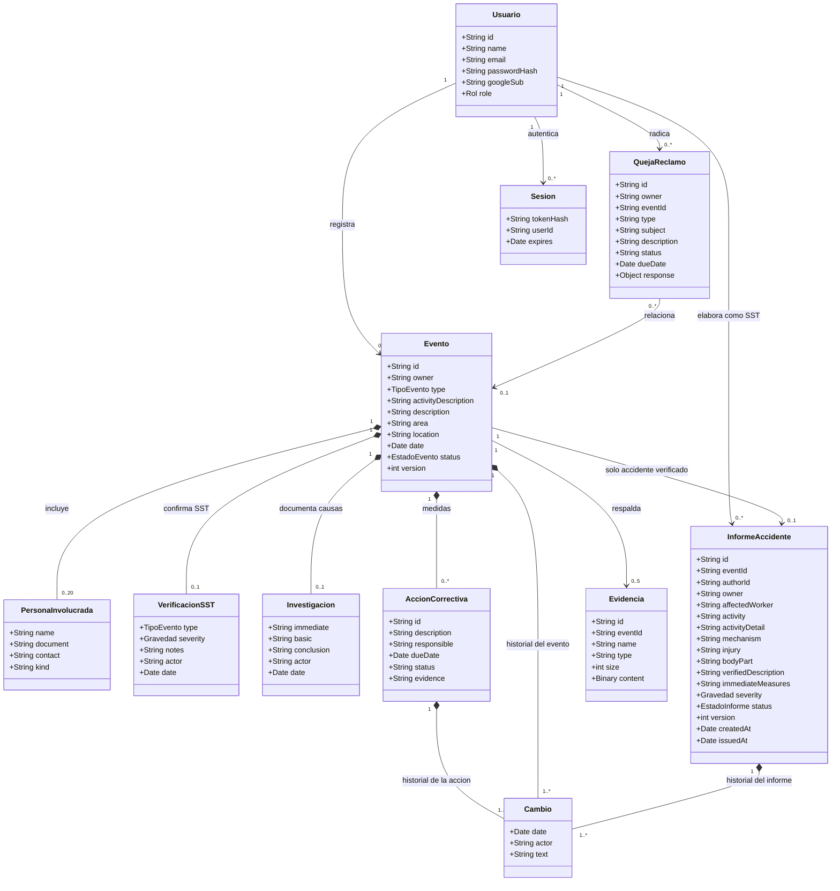

# Diagrama de clases

Modelo de dominio de la versión 1.0. El servidor está implementado con funciones y documentos MongoDB; este diagrama expresa las entidades y sus relaciones, no una jerarquía de clases Java.

Reglas: solo el trabajador registra eventos y adjunta evidencia a sus casos abiertos. SST verifica, investiga y elabora informes. Coordinador y administrador consultan los eventos; SST y administrador responden quejas. La gravedad se registra únicamente para accidentes: Leve, Grave o Mortal. Los incidentes conservan investigación sin generar InformeAccidente. El informe pasa de Borrador a Emitido; emitirlo no cierra el evento. El cierre exige acciones completas con evidencia y, en accidentes, el informe Emitido.

En Usuario, el hash de contraseña corresponde a cuentas locales y `googleSub` es opcional para cuentas Google. El primer acceso con Google crea un Trabajador; la sesión y los permisos operativos son los mismos para ambos métodos.
