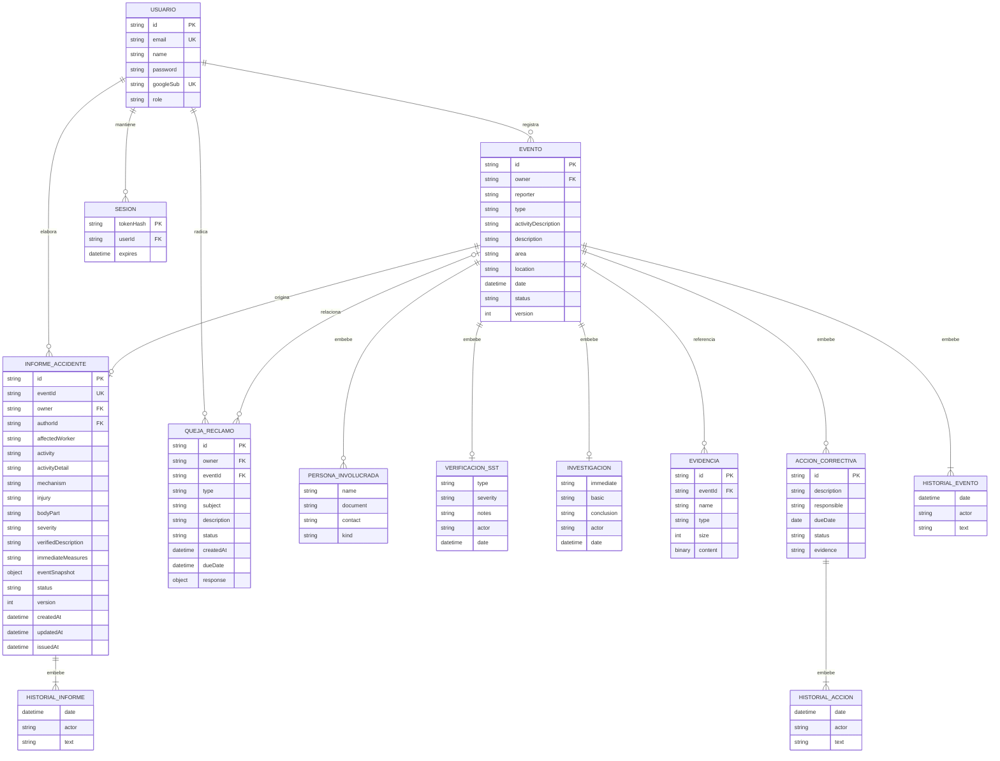

# Diagrama entidad-relación

Modelo lógico de documentos MongoDB, versión 1.0. Las relaciones representan referencias y documentos embebidos; MongoDB no aplica claves foráneas SQL. Los identificadores de dominio son cadenas, además del `_id` interno de MongoDB.

Colecciones físicas: `users`, `events`, `accidentReports`, `evidence`, `sessions`, `complaints`, `attempts` y `oauthStates`. Personas, verificación, investigación e historiales son subdocumentos; no son colecciones independientes. `attempts` limita los intentos de login y `oauthStates` conserva durante cinco minutos el estado, nonce y verificador PKCE del acceso con Google; son colecciones técnicas.

En USUARIO, `password` contiene un hash solo para cuentas locales y `googleSub` el identificador estable solo para cuentas Google. El índice de `googleSub` es único y `sparse`, de modo que permite cuentas locales sin ese campo. Las cuentas nuevas de Google reciben rol Trabajador; no se vinculan cuentas locales automáticamente por coincidencia de correo.

El índice único `accidentReports.eventId` impide crear dos informes para el mismo accidente. La relación Evento-Informe es opcional: primero existe el evento; el informe se crea posteriormente y solo si se verificó como accidente. La validación de esta condición se realiza en la API.
