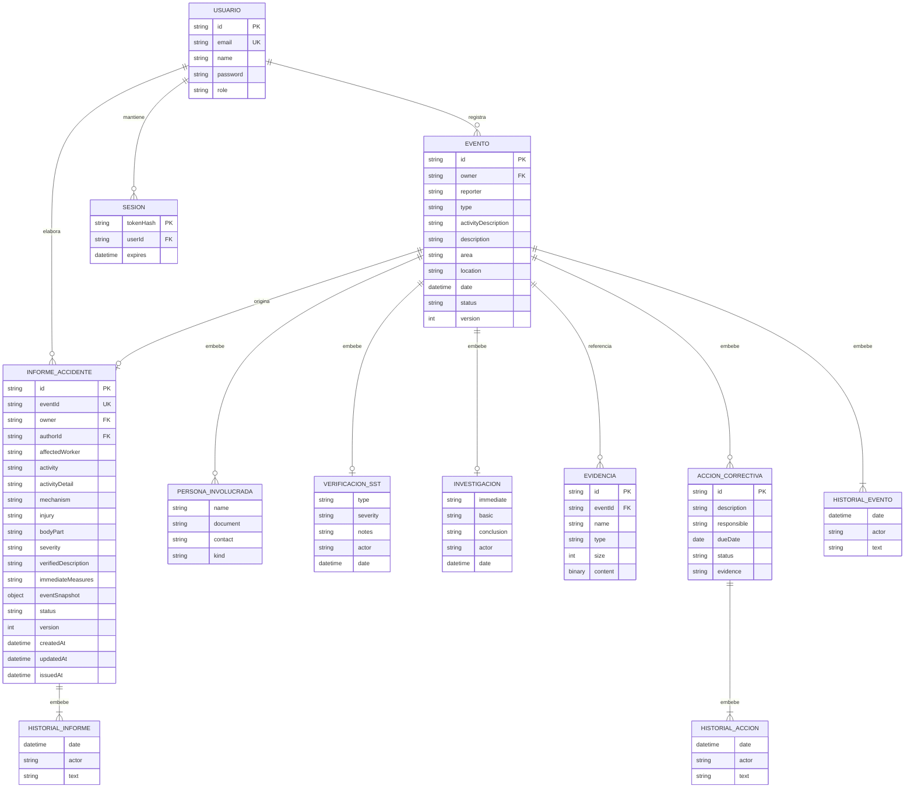

# Diagrama entidad-relación

Modelo lógico de documentos MongoDB, versión 0.3. Las relaciones representan referencias y documentos embebidos; MongoDB no aplica claves foráneas SQL. Los identificadores de dominio son cadenas, además del `_id` interno de MongoDB.

Colecciones físicas: `users`, `events`, `accidentReports`, `evidence`, `sessions` y `attempts`. Personas, verificación, investigación e historiales son subdocumentos; no son colecciones independientes. `attempts` es almacenamiento técnico del límite de intentos de login y no forma parte del dominio del evento.

El índice único `accidentReports.eventId` impide crear dos informes para el mismo accidente. La relación Evento-Informe es opcional: primero existe el evento; el informe se crea posteriormente y solo si se verificó como accidente. La validación de esta condición se realiza en la API.
