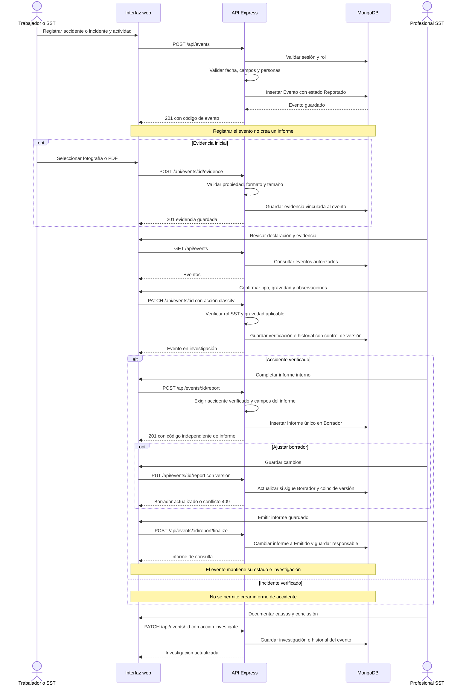

# Diagrama de secuencias

Recorrido principal implementado en la versión 0.2. La sesión debe existir antes de las operaciones de escritura.

La API devuelve 403 ante un rol no autorizado, 400 ante campos inválidos y 409 cuando falta verificación, existe un informe duplicado o la versión cambió. La investigación está disponible para ambos tipos de evento y no exige emitir primero un informe.
