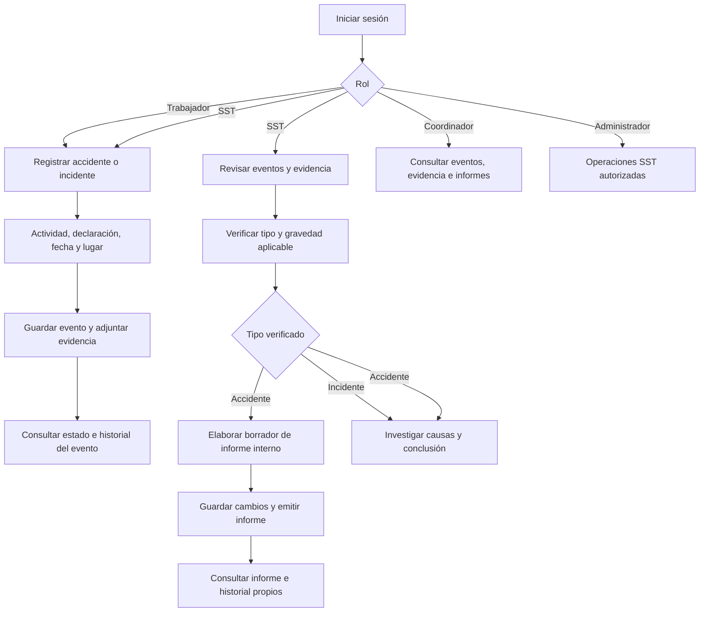

# Flujo de usuario

El trabajador puede consultar el informe asociado a su evento, pero no modificarlo. SST puede investigar un accidente antes o después de elaborar el informe. Emitirlo no equivale a cerrar el caso. La administración completa de usuarios continúa pendiente.
