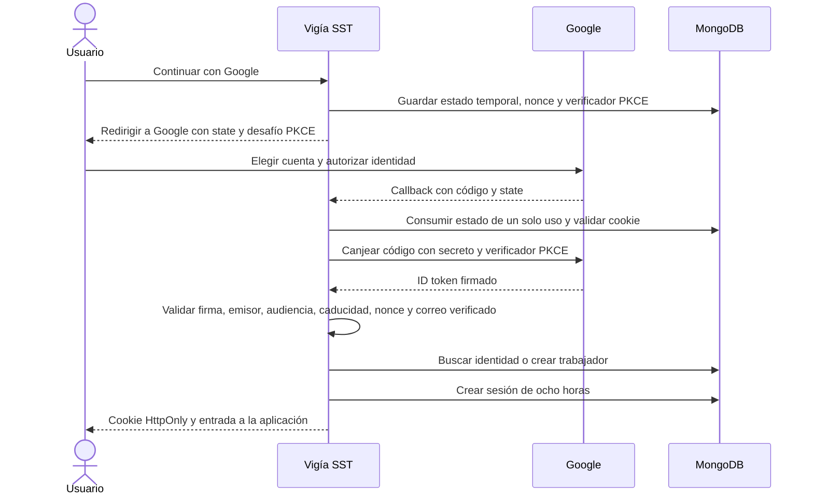

# Registro e inicio de sesión con Google

La integración es opcional. El código incluye el botón **Continuar con Google**, que registra al usuario la primera vez y permite iniciar sesión después. Se muestra solamente cuando el servidor tiene las tres variables de Google válidas. Sin esa configuración sigue disponible el acceso actual mediante correo y contraseña.

## Configuración

1. Entrar en [Google Cloud](https://console.cloud.google.com/auth/clients) con la cuenta responsable del proyecto y seleccionar o crear un proyecto.
2. Configurar Google Auth Platform: nombre de la aplicación `Vigía SST`, correo de soporte y audiencia externa. Si se mantiene en pruebas, añadir los correos que van a probarla en la lista de usuarios de prueba. Completar los avisos o autorizaciones que Google solicite con la persona dueña de la cuenta.
   En Información de la marca, indicar la página principal `https://vigia-sst-io46.onrender.com` y la privacidad `https://vigia-sst-io46.onrender.com/privacidad.html`. El aviso es público y describe el tratamiento real de los datos del prototipo. Publicar la app en Google y la verificación de marca son pasos distintos; atender los requisitos que muestre Google antes de afirmar que cualquier cuenta puede acceder.
3. Crear un cliente OAuth de tipo **Aplicación web**. Añadir exactamente esta URI de redirección autorizada para Render:

   ```text
   https://vigia-sst-io46.onrender.com/auth/google/callback
   ```

   Para desarrollo local, añadir también `http://localhost:3000/auth/google/callback` (o el puerto real utilizado). La URI configurada en el servidor debe coincidir exactamente con la autorizada en Google, sin barra final adicional.
4. Configurar las variables privadas del servicio en Render, o en el archivo `.env` para desarrollo:

   | Variable | Contenido |
   | --- | --- |
   | `GOOGLE_CLIENT_ID` | ID del cliente web emitido por Google |
   | `GOOGLE_CLIENT_SECRET` | Secreto del mismo cliente; nunca se publica |
   | `GOOGLE_REDIRECT_URI` | URI autorizada correspondiente al entorno |

5. Desplegar el commit con la integración. En Render deben mantenerse `NODE_ENV=production` y `COOKIE_SECURE=true`. No es necesario cambiar `DEMO_PASSWORD` ni las cuentas existentes.
6. Comprobar `/api/auth/config`: debe responder `{"google":true}` sin mostrar credenciales. Abrir la aplicación, elegir **Continuar con Google** y completar la autorización de identidad.

## Comportamiento

- Una identidad nueva de Google crea una cuenta con rol **Trabajador**. No permite elegir SST, coordinador ni administrador desde el formulario o la URL.
- Al volver a entrar se busca el identificador estable de Google (`sub`) y se conserva la misma cuenta y su rol guardado.
- No se vincula automáticamente una cuenta local que tenga el mismo correo. En ese caso se pide ingresar con su contraseña habitual; la vinculación explícita queda fuera del alcance.
- La contraseña de Google nunca se recibe ni se almacena en Vigía. Las cuentas creadas con Google usan ese botón para volver a entrar; no tienen contraseña local.
- Se utilizan únicamente los permisos `openid`, `email` y `profile`. No se solicita acceso a Drive, Gmail ni otros datos.
- Las cuentas existentes de demostración conservan su acceso por correo y contraseña.

## Flujo y seguridad



Los estados caducan en cinco minutos y se eliminan automáticamente mediante un índice TTL. Un callback vencido, repetido o sin la cookie del navegador no abre sesión. El secreto y los tokens del proveedor no se envían a la interfaz ni se guardan como datos de usuario.

## Pruebas

`test/google-auth.test.js` verifica el registro, el acceso posterior, los roles, la colisión con cuentas locales y los rechazos por estado, firma, audiencia, emisor, caducidad, nonce y correo no verificado. Sustituye las llamadas de red a Google por respuestas controladas y utiliza firmas RSA reales y la verificación criptográfica de la biblioteca oficial.

Estas pruebas no equivalen a una autorización real con una cuenta de Google. La prueba final sobre Render debe realizarse después de configurar las credenciales: entrar por primera vez, comprobar el rol Trabajador, salir y volver a entrar sin duplicar la cuenta. No publicar el secreto ni capturas que lo contengan.

El 22 de noviembre de 2026 se completó también una autorización real en un entorno local, con creación de cuenta Trabajador y reingreso posterior. La activación en la URL pública sigue pendiente de configurar las variables en la cuenta de Render responsable y de comprobar el despliegue. El estado de publicación de Google y sus requisitos deben revisarse antes de ofrecer el registro a cualquier cuenta externa.

Referencias: [OpenID Connect de Google](https://developers.google.com/identity/openid-connect/openid-connect) y [flujo OAuth para aplicaciones web](https://developers.google.com/identity/protocols/oauth2/web-server).
